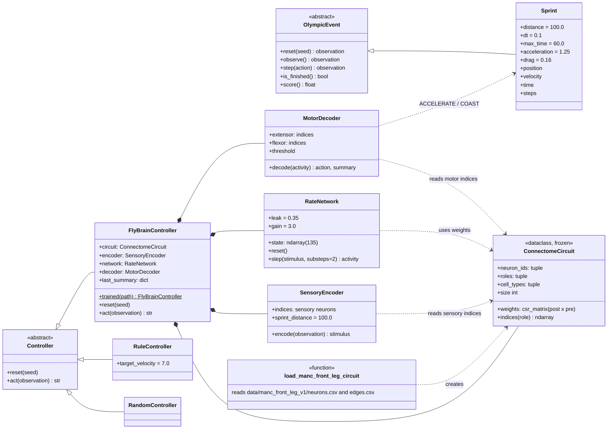
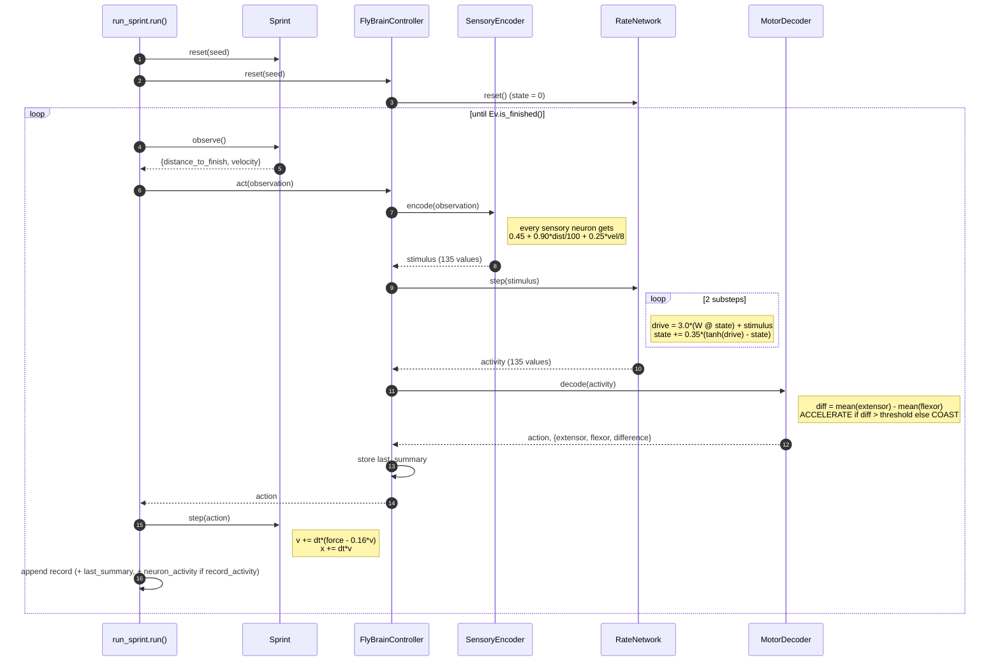
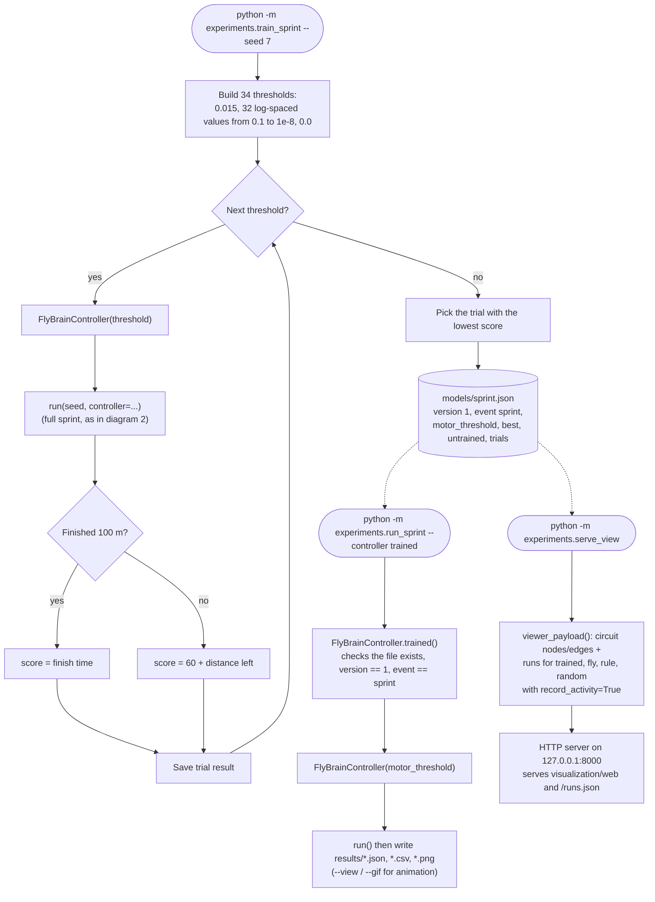
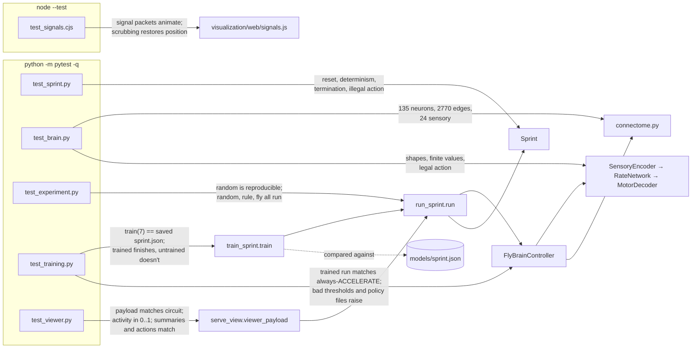

# Flympics brain: UML

These diagrams show how the connectome-derived controller in `brain/` drives the
100 m sprint, and how training and the tests run.

## 1. Class diagram

`FlyBrainController` is one of three controllers behind the `Controller`
interface. `Sprint` sees only observations and actions, so it never touches the
neural model.

## 2. Sequence diagram: one sprint step

`experiments/run_sprint.py::run()` repeats this loop until the runner reaches
100 m or 60 s passes (at most 600 steps of 0.1 s).

## 3. Activity diagram: training and using the trained policy

Training only searches for `motor_threshold`. The connectome weights, leak and
gain never change.

## 4. Test map

Run the Python tests with `python -m pytest -q`. The one JavaScript test runs
separately with `node --test tests/test_signals.cjs`.

**Note:** `test_training.py` checks that `train(seed=7)` reproduces
`models/sprint.json` exactly. Any change to `brain/` or `events/sprint.py` that
changes behavior means you must run `python -m experiments.train_sprint` again
and commit the new policy file. Otherwise that test fails.
