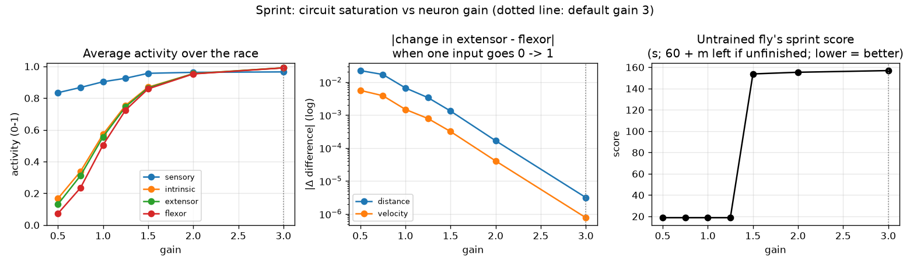

# Circuit saturation across events

The saturation report compares the untrained MANC rate-network controller across Sprint,
Hurdles, Swimming, Pacing, Steeplechase, and Archery at gains `0.5, 1, 1.5, 2, 3`.
Gain is a modeling choice, not MANC data: the connections come from MANC, but how
strongly each neuron responds to its total input is our assumption (`RateNetwork`
defaults to 3.0, and this report does not change that default).

Run one event with:

```sh
python -m experiments.saturation_report --event sprint
```

Each run writes `results/saturation/<event>.csv` and `.png` and prints a results table.
`results/` is not tracked in git, so run the script to regenerate them.

## Measurements

- At every race step, the report records each group's mean activity and the percentage of
  sensory, intrinsic, extensor, and flexor neurons with activity **greater than 0.95**.
  It averages these percentages over the race.
- For each encoder input, it compares the settled extensor-minus-flexor readout at that
  input's low and high values, holding other inputs at their midpoints. The network resets
  and settles for 50 steps for each value. Archery aim and wind use `[-1, 1]`; draw and
  other event inputs use `[0, 1]`.
- Each event's untrained controller runs a fixed setup (Hurdles uses its benchmark layout;
  Archery uses seed 7). The score follows that event's scoring rule. Archery is higher-is-
  better; other events are lower-is-better.

## Default gain (3.0)

Percentages below are race averages: within each group, the share of neurons above 0.95.
Scores have different units and should only be compared within their event.

| Event | Sensory % | Intrinsic % | Extensor % | Flexor % | Largest input effect | Score |
|---|---:|---:|---:|---:|---:|---:|
| Sprint | 74.6 | 99.2 | 99.2 | 99.2 | 3.13e-6 | 156.9 |
| Hurdles | 74.9 | 99.7 | 99.7 | 99.7 | 1.98e-6 | 288.0 |
| Swimming | 74.9 | 99.8 | 99.8 | 99.8 | 1.98e-6 | 201.2 |
| Pacing | 74.9 | 99.8 | 99.8 | 99.8 | 1.98e-6 | 635.3 |
| Steeplechase | 99.9 | 99.8 | 99.8 | 99.8 | 7.93e-7 | 836.9 |
| Archery | 70.3 | 91.3 | 92.2 | 91.1 | 1.94e-5 | 47 / 60 |

Across all six events, input effects are smaller at gain 3 than at gain 0.5. Intrinsic and
motor groups are almost entirely above 0.95 in five events. Archery remains less saturated
by this threshold and its score rises with gain, so saturation does not imply the same
behavioral outcome for every decoder or event.

## Across gains

The untrained fly's score at each gain (same setups as above):

| Event | 0.5 | 1 | 1.5 | 2 | 3 |
|---|---:|---:|---:|---:|---:|
| Sprint (s) | 18.8 | 18.8 | 153.8 | 155.3 | 156.9 |
| Hurdles (s) | 58.4 | 58.4 | 286.9 | 287.7 | 288.0 |
| Swimming (s) | 205.2 | 205.2 | 202.7 | 201.8 | 201.2 |
| Pacing (s) | 198.2 | 198.2 | 631.2 | 633.2 | 635.3 |
| Steeplechase (s) | 238.5 | 238.5 | 833.8 | 835.3 | 836.9 |
| Archery (points / 60) | 0 | 0 | 44 | 46 | 47 |

Intrinsic and motor neurons go from none above 0.95 at gain 1.5 to nearly all of them at
gain 2, so the switch into saturation happens between those two gains.

At gain 1 or lower, the untrained fly finishes Sprint, Hurdles, Pacing and Steeplechase,
where at gain 3 it times out. That is not the fly getting smarter: the untrained decoder's
threshold now falls on the "accelerate" side, so it pushes on every step (in Sprint that is
already the fastest possible time). Archery goes the other way: at low gain the untrained
fly never releases, so it scores 0. What lower gain does buy is input sensitivity: in
Sprint the distance input moves extensor minus flexor by 2.2e-2 at gain 0.5 versus 3.1e-6
at gain 3, so training has something to work with.



## Limits

These are modeled activity values, not recorded biological firing rates. The low/high
input test uses constant stimuli and one 50-step settling period; real event inputs change
over time. One fixed run is reported per gain, so stochastic variation is not estimated.
