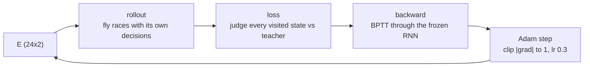

# Always-Accelerate: encoder-only training

The first supervised experiment for the Flympics brain. It runs on the unchanged
Sprint v1. The fly learns to always accelerate, and the only thing that learns is
its **sensory encoder**: two weights per sensory neuron.

Read [brain-uml.md](brain-uml.md) for the class names used here.

## Why this task

In Sprint v1, force is constant and drag only slows the fly, so ACCELERATE is the
best action in every state. The teacher is therefore one line: always ACCELERATE.
The best race is 100 m in 18.7 s (187 steps, top speed 1.25 / 0.16 = 7.81 m/s).

The task is simple on purpose. Because the right answer is known, any change in
the data comes from the learning, not from the label.

## What is trained and what is frozen

| Part | Status |
|------|--------|
| Encoder weights `E`, shape (24, 2): one distance weight and one velocity weight per sensory neuron | **trained** |
| Tonic drive 0.45, input scaling `d/100` and `v/8` | frozen |
| Connectome `W` (135×135, 2770 MANC edges), gain 3.0, leak 0.35, 2 substeps | frozen |
| `MotorDecoder`: extensor − flexor > **0.015** (the untrained default) | frozen |

The stimulus each sensory neuron receives:

```
stimulus[sensory] = 0.45 + E[:, 0] * clip(distance_to_finish / 100) + E[:, 1] * clip(velocity / 8)
stimulus[other]   = 0
```

`fingerprint()` hashes `W`, gain, leak, the threshold and the motor indices before and
after training. Training raises an error if the hash changes.

## Files

| File | Role |
|------|------|
| `models/sprint_encoder_init.csv` | The frozen baseline: every neuron gets (0.90, 0.25). With these weights the new encoder reproduces the original `SensoryEncoder` exactly. Never overwritten. |
| `models/sprint_encoder.csv` | The trained weights. Training writes this file. |
| `brain/sensory.py` | `LearnedSensoryEncoder`, `initial_encoder_weights`, `load_encoder_weights`, `save_encoder_weights` |
| `brain/controller.py` | `FlyBrainController(encoder_weights=...)` and `FlyBrainController.always_accelerate()` |
| `experiments/train_always_accelerate.py` | rollout, replay, loss, backward, train, CLI |
| `tests/test_always_accelerate.py` | The guarantees listed below |

CSV format: one row per input→sensory edge, `pre,post,weight`, where `pre` is
`distance` or `velocity` and `post` is the MANC id of a sensory neuron. Rows are
matched by id. Unknown inputs, non-sensory ids, duplicates, missing edges and
non-finite weights are rejected.

## One epoch



1. **Rollout (on-policy).** The fly runs the full sprint with the current `E`, and its
   own decisions move it. The rollout records the inputs it saw, its actions, the
   motor difference behind each decision, and `tanh(drive)` for every substep.
2. **Loss.** The teacher says ACCELERATE at every visited state. The decision itself
   (a threshold) has no gradient, so the loss uses the continuous motor difference:

   ```
   shortfall = max(0, (0.015 + 0.035) - difference)
   loss      = mean(shortfall^2)
   ```

   This is a squared hinge with target 0.05. The 0.035 margin keeps pushing until
   the fly is clearly past the threshold, not just barely over it. A step at
   difference 0 costs more than one at 0.015, and a step at or above 0.05 costs
   nothing.
3. **Backward (BPTT).** The pass walks the steps in reverse through each substep
   `state += leak * (tanh(gain * W @ state + stimulus) - state)`. The path the fly
   took is held fixed for the epoch: changing `E` changes the differences, not the
   observations. It is written in NumPy, with no PyTorch, and checked against
   finite differences using `replay` (the same network on fixed inputs).
4. **Update.** Adam (β = 0.9, 0.999), written by hand in `train()`, with
   global-norm clipping at 1. There is no weight decay. The network is saturated,
   so raw gradients are about 1e-6, and Adam's per-weight scaling still moves
   each weight by about `lr` per epoch.

Each history row describes the weights *before* that epoch's update, so the
returned weights are always ones that raced. Training stops when the loss
reaches 0 or `--epochs` runs out.

## Results (default settings)

| epoch | loss | distance | time | ACCELERATE |
|------:|-----:|---------:|-----:|-----------:|
| 1 | 2.48e-3 | 3.1 m | 60 s (timeout) | 0.7% |
| 7 | 2.14e-3 | 57.8 m | 60 s | 12% |
| 10 | 1.11e-3 | 100 m | 24.9 s | 55% |
| 14 | 2.8e-6 | 100 m | 18.7 s | 100% |
| 300 | 1.75e-6 | 100 m | 18.7 s | 100% |

The trained fly matches the always-ACCELERATE reference: 187 steps, 100 m in 18.7 s.

**Known limit.** The loss never reaches 0. On step 0 the network starts from
all zeros, and input moves one synapse further per observation, so the first
difference stops at about 0.032. That is above the 0.015 threshold, so the fly
still accelerates, but it is below the 0.05 target. Every later step is far above
the target (median about 0.9). Because of this, a run uses all `--epochs`.

The weights move far from the start (|E − E0| ≈ 16, range −3.9 to 6.1). Three
sensory neurons (100324, 101007, 101691) have no outgoing synapses, so their
weights get zero gradient and never change.

## Running it

```bash
python -m experiments.train_always_accelerate             # writes models/sprint_encoder.csv
python -m experiments.run_sprint --controller accelerate  # 100 m in 18.7 s
```

Options: `--init` (default `models/sprint_encoder_init.csv`), `--output` (default
`models/sprint_encoder.csv`; refuses to overwrite the init file), `--epochs` (300),
`--lr` (0.3), `--results-dir` (`results/always_accelerate`, which gets
`history.csv` and `history.png`).

## What the tests guarantee

- The init CSV equals (0.90, 0.25) per neuron, and saving then loading a CSV
  returns exactly the same weights. Each kind of bad CSV raises a clear error.
- With the init weights the new encoder is bit-identical to `SensoryEncoder`, and
  a race equals `run("fly")`.
- The stimulus reaches only sensory neurons.
- `rollout` equals the real controller's race, and `replay` equals `rollout`.
- `backward` matches finite differences, and the 3 isolated neurons get zero gradient.
- Training leaves the frozen fingerprint unchanged, reaches 100 m with 100%
  ACCELERATE within 15 epochs, and is bit-for-bit reproducible.
- `--output` cannot overwrite the init file.
- `--controller accelerate` matches the always-ACCELERATE reference, and the
  threshold stays 0.015.

## Next steps (not built)

- A stop rule that does not need loss 0, such as stopping at 100% ACCELERATE or when the loss stops improving.
- A sprint where the best action depends on the state, such as stamina, so the
  teacher's labels vary and the encoder has to read distance and velocity rather
  than learn a constant push.
- Add `accelerate` to the web viewer (`experiments/serve_view.py` and `visualization/web`).
